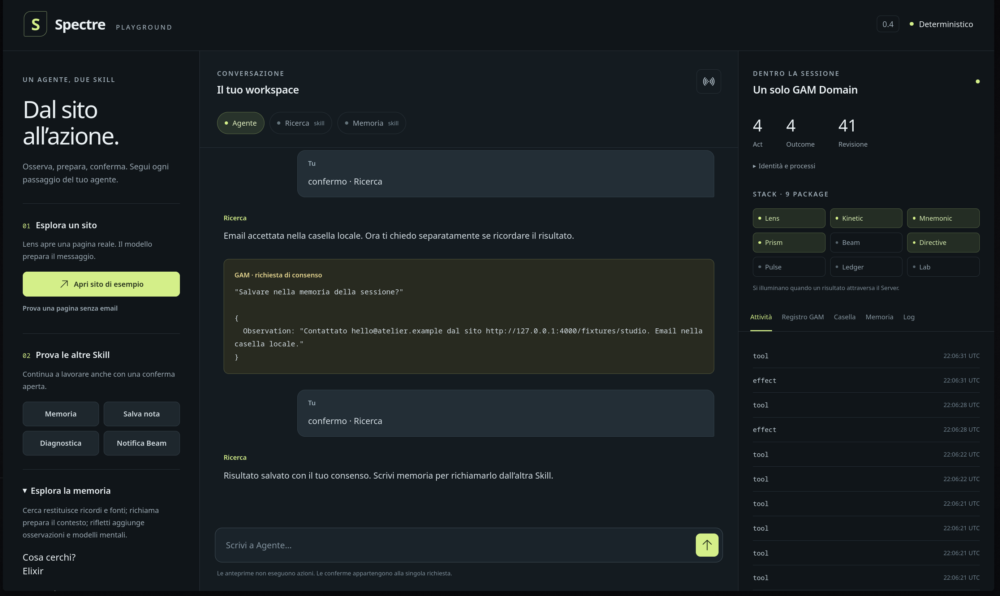

# Spectre 0.4 Playground

A Phoenix LiveView chat with **one Agent, two reusable Skill GenServers and one
shared GAM Domain**. No database, no authentication scaffolding and no API key
required for the default mode. This application lives beside the Spectre
repositories; it is not part of the core package.



Two independent Skills, separate email and memory consent, nine installed
packages, and one shared GAM Domain.

**The demo is already on the automatic GAM architecture.** `AgentServer`,
Research's `OutreachServer` and `KnowledgeServer` are separate processes sharing
the root's existing GAM connection, one Domain and one authority ledger. Each
owns its state, workers, streams, pending intentions and checkpoint. Session
startup configures GAM once; there is no application Host or per-Skill bootstrap.

Both root operation permissions and each mount's `governed:` references apply.
Every proposal records its Skill provenance. Confirming Research's email cannot
approve Knowledge's note or the separate memory-save request. Timers record
lifecycle changes in the shared Domain without erasing Duties. See the
[source walkthrough and parallel-Skill exercise](docs/SHARED_GAM.md).

## Run

Clone this repository on its own. Core and all nine packages are fetched from
**exact Git commits** in [spectre.lock.exs](spectre.lock.exs); [mix.lock](mix.lock)
pins their transitive dependencies. No sibling checkout or API key is required.

Use Elixir 1.19 or newer, OTP 28 or newer, Node 22, and a C build toolchain.
Vettore uses its published native library; set `VETTORE_BUILD=1` and install Rust
1.91 or newer to build it locally, as CI does. No database is needed.

```sh
git clone https://github.com/elchemista/demo_spectre.git
cd demo_spectre
mix local.hex --force
mix local.rebar --force
elixir scripts/check_spectre_pins.exs
mix setup
# Linux x86_64: installs the checksum-pinned Lightpanda 1.0.4 artifact.
bash scripts/install_browser.sh
mix phx.server
```

On another platform, install a supported Lightpanda using the
[Lens browser guide](https://github.com/elchemista/spectre_lens/blob/feature/stack-tools-0.4/docs/STANDALONE.md)
and set `LIGHTPANDA_PATH` to its executable. The pinned Linux installer and CI
use the same browser release; an existing binary is not silently replaced.

Open **http://localhost:4000**. `PORT` overrides the development port; generated
fixture links follow it. Tests use their own port, 4002.

For development across sibling repositories only, explicitly set
`SPECTRE_LOCAL_DEPS=1` for Mix commands:

```sh
# demo_spectre sits beside spectre, spectre_kinetic, ..., spectre_lab.
SPECTRE_LOCAL_DEPS=1 mix setup
SPECTRE_LOCAL_DEPS=1 mix test
SPECTRE_LOCAL_DEPS=1 mix phx.server
```

Local mode intentionally uses the working trees and is not the reproducible
release build. Keep the committed pins and lockfile intact. Maintainers update
pins **after committing all ten repositories** with
`elixir scripts/update_spectre_pins.exs ../`, then publish those commits and run
the [clean-clone CI workflow](.github/workflows/verify.yml). The check script
validates pin consistency; fetching/building from a clean clone verifies that
GitHub actually contains the commits and that the complete demo works.

## Try the showcase

1. **Apri sito di esempio** visits the local Atelier website in real Lightpanda.
   Research recalls memory, initializes a Directive, selects the Prism model,
   reads the page with Lens and streams the model's draft.
2. The model's consolidated Action Language enters **Kinetic**. Its proposal
   goes through GAM; no mail action runs while it is merely a preview.
3. Inspect the exact recipient and body, then **Confermo** or **Annulla**.
   A successful send appears in **Casella**. The mail transport is local only.
4. Saving the result in **Mnemonic** requires a **second confirmation**. Read it
   back with **Memoria**, which runs in the independent Knowledge Skill. Opening
   the same link again checks that saved memory and proposes no new email.
   For other notes, use `memoria BETA-nuova` or other words from the saved note.
   The default button searches contact-related terms; it is not a full memory
   inventory and an empty recall does not mean that nothing was saved.
5. While Research is waiting, run **Diagnostica**, **Salva nota** or root `status`.
   The process identities are visible under **Identità e processi**. A native
   OTP message can also be sent to Knowledge's `handle_info`.
6. **Sospendi** sends a different topic to Research and schedules closure after
   30 seconds. **Riprendi** before expiry shows a fresh presentation. A previous
   confirmation button cannot approve a newer revision.
7. **Notifica Beam** proposes a local Beam delivery with its own consent.
8. **Prova una pagina senza email** covers the no-contact path without proposing
   a send. The inspector's tool badges light up as results return.

The chat target selector chooses root, Research or Knowledge. Untargeted “yes”
never guesses which Skill to approve. Use the consent card's exact controls.

## Memory, semantic cache and the hello action

- **Esplora la memoria** accepts a query and an explicit operation: flat search,
  context recall or reflection with sources. Search results appear under
  **Memoria**, with source and identifier. **Dimentica…** presents the selected
  text and requires a fresh GAM confirmation; it hides that record, not every
  derived entity. **Mappa** inspects the graph.
- `impara Rilascio - Esegui i test` proposes reusable knowledge, separately from
  a note. Confirm it, then open **Conoscenze**. Learning requires its own binding.
- **Hello + consenso** calls the model. Its completed `<al>LOG HELLO ...</al>`
  goes through Kinetic and GAM. Only **Confermo** invokes the real Logger action
  (`[demo.kinetic] hello`); **Log** shows the corresponding admitted receipt.
- **Prova parafrasi** sends “come procede il lavoro?”. The inspector reports the
  actual vector-cache strategy. “mostrami lo stato” is an exact dataset hit;
  “quali altri ricordi conosci?” delegates to the Memory Skill through vector
  lookup. Unknown text falls back; explicit regex commands keep precedence.

The intent encoder is deliberately deterministic. **Vettore quantized retrieval
and cosine ranking are real**, but this is not a neural semantic-quality test.
IntentDataset stores labeled examples; only rows with compatible embeddings
enter its vector projection. It is distinct from Mnemonic's user memory. The
public sample dataset is shared and immutable in this demo; automatic collection
is disabled so private chat text does not enter a shared training dataset.

Regenerate the vector artifact from reviewed source examples with:

```sh
mix spectre.intent_dataset.embed DemoSpectre.Agent priv/intents/source.jsonl priv/intents/prepared.jsonl
```

This prepares embeddings, not a classifier model. The core suite separately
checks online collection, verification, editing/re-embedding, incompatible model
profiles and classifier-training companion artifacts.

## Architecture and source map

```text
LiveView (rendering and explicit user input)
└── Session (local UI identity, Stack resources and event relay)
    ├── Ledger coordination store
    └── Agent Server.Runtime
        ├── managed GAM boundary / Domain / authority ledger
        └── Skill supervisor
            ├── OutreachServer / Research
            └── KnowledgeServer / Memory and diagnostics

All governed Skill operations → standard Server.GAM integration
                             → shared Domain → registered effect adapter
Session-owned Stack.Runtime → browser pool and Mnemonic engine
```

`Session` configures `gam: [storage: {:disk, path}, operations: ...]`. The authority ledger and coordination checkpoints are both
written locally to disk. Spectre provides the Domain bootstrap, typed proposals,
presentations, ingress and executor. There is **no application Host module**.
`handle_action/2` in the Skill Server contains only business checks: the recipient
must match the contact observed with Lens, and forgetting a record requires a
result actually returned by search. `Contacts` reads structured `mailto:` links
and semantic page text, preserves source URL and observation provenance, and
stops before generation if distinct contacts are ambiguous. A model cannot
replace that observed recipient; GAM binds the provenance to the presentation. Unchanged callbacks use the framework defaults.

The children receive the existing integration automatically, not fresh Domains
or new grants. Their own checkpoint keys store local continuations; the GAM
history is shared. Cognition and workers may proceed in parallel, while the
kernel orders admission under the same laws. **Identità e processi** displays
the distinct PIDs under one Domain; **Registro GAM** is their common authority
projection, including Skill invocation Evidence.

The standard path remains customizable. A Server can implement `handle_pending`
and native OTP callbacks or override one operation without constructing GAM
records. There is one automatic GAM integration in every environment; callbacks
can restrict business requests but cannot replace admission or manufacture
consent. See the [responsibility boundaries](../spectre/docs/MANAGED_GAM.md).

Read declarations before implementations:

| File | Responsibility |
| --- | --- |
| [ai.ex](lib/demo_spectre/ai.ex) | Installs all nine libraries; package descriptors generate helpers |
| [agent.ex](lib/demo_spectre/agent.ex) | Root flows and scoped Skill mounts with operation allowlists |
| [skills/outreach.ex](lib/demo_spectre/skills/outreach.ex) | Reusable URL/status/resume routes |
| [skills/knowledge.ex](lib/demo_spectre/skills/knowledge.ex) | Memory, diagnostics and notification routes |
| [skills/outreach_server.ex](lib/demo_spectre/skills/outreach_server.ex) | Lens → model → Kinetic → consent → local email → memory consent |
| [skills/knowledge_server.ex](lib/demo_spectre/skills/knowledge_server.ex) | Independent callbacks using the same Stack helpers |
| [contacts.ex](lib/demo_spectre/contacts.ex) | Structured observed contacts, provenance and explicit ambiguity |
| [knowledge/](lib/demo_spectre/knowledge) | Plain memory formatting and diagnostic/notification presentation modules |
| [pending.ex](lib/demo_spectre/pending.ex) | Ordinary Elixir policy: confirm/reject/suspend and audited timer |
| [session.ex](lib/demo_spectre/session.ex) | Session lifecycle, child resources and event relay |
| [chat_live.ex](lib/demo_spectre_web/live/chat_live.ex) | LiveView chat, consent correlation and read-only GAM projection |

The show executor waits for a browser hook acknowledgement before reporting a
successful presentation. That acknowledgement is **not approval**. Approval is
a structured decision pinned to the authenticated UI owner, Skill, pending ID,
presentation reference and revision. A browser click is not converted into a
synthetic chat message. The kernel
still validates the bound consent Evidence. See the
[GAM manifesto](https://spectre.guide/en/governed-act-model) and
[Skill guide](../spectre/docs/SKILLS.md).

## What is real, what is deterministic

| Capability | Demo behavior |
| --- | --- |
| Lens | Real Lightpanda runtime, local HTTP fixture, browser extraction and tab cleanup |
| Model | Deterministic AL generator and pull stream through Spectre's normal streaming boundary |
| Kinetic | Real parsing/planning of the completed model output; scoped proposals |
| GAM | Real Domain, typed surface, mandate, authenticated ingress, admission and ledger |
| Mnemonic | Real local engine; isolated search/recall/reflection/graph, consented save/learn/forget |
| IntentDataset | Real exact/vector routing; reviewed vectors, deterministic encoder |
| Prism / Directive | Real selection and task construction |
| Beam | Real helper/admission path; transport writes only a local receipt |
| Pulse | Real protocol inspection; no remote agent transport is configured |
| Ledger / Lab | Real checkpoint lookup, durable coordination store and canonical validation |

This demonstrates representative operations in all nine packages, not every
capability or external provider. The activity panel is an application trace;
**Registro GAM** uses `Spectre.Server.gam_inspect/2`: a payload-free, paginated
projection of recorded authority facts. `Spectre.Lab.inspect/3` supplies the
**Diagnostica operativa** checkpoint metadata. Session subscribes to runtime and
GAM changes; the LiveView coalesces notifications instead of polling the full
ledger. **Carica altri record** advances a cursor pinned to the current revision;
a changed revision restarts the page. The inspector keeps at most 200 displayed
records. Counts refer to the entire projection, not only visible rows.
Presentations still arrive separately for explicit consent; the diagnostic API
does not expose their payloads, private assigns, prompts, or tool arguments.
The UI never receives a Scope or submission credential.
See the [updated inspector screenshot](docs/screenshots/desktop.png).
No SMTP service is configured and no message leaves the local demo.

Knowledge deliberately mounts memory, diagnostics and notifications together to
show all nine tools in two actors. Its ordinary `Knowledge.Memory` and
`Knowledge.Diagnostics` modules separate presentation responsibilities; tool
orchestration stays in the Server and the same GAM loop. An application with
independent authorization/lifecycle boundaries can mount separate Skills. An
unknown successful continuation is reported as a diagnostic and never retried.

## Optional OpenRouter

Set these in the shell environment before restarting, without putting keys in
source or the chat:

```sh
export DEMO_MODEL=openrouter
export OPENROUTER_MODEL='provider/model-you-want-to-test'
# Set OPENROUTER_API_KEY securely in your environment.
mix phx.server
```

The explicit `DEMO_MODEL` flag enables the remote call; a key alone does not.
The adapter uses [OpenRouter Chat Completions](https://openrouter.ai/docs/api_reference/overview)
with `Req`. It sends the rendered prompt, including the observed fixture page
and recalled session memory. This optional path is **non-streaming**; streaming
is exercised by the deterministic provider. The rest of the Kinetic/GAM loop is
unchanged and the Skill Server checks the recipient against the observed contact.
Credentials and live model output must be verified separately with your chosen
provider. Return to the default by unsetting `DEMO_MODEL`.

## Verification

```sh
mix precommit
# With the deterministic development server running on port 4000:
npm ci
npx playwright install chromium ffmpeg
npm run test:browser
```

The session tests visit real HTTP fixtures with Lens/Lightpanda and exercise the
model/Skill/tool/GAM loop. The local ExUnit endpoint uses port 4002. The browser
suite drives the actual LiveView with Chromium, including real JavaScript hooks,
WebSocket reconnection, deliberately malformed client events and lost rendering
acknowledgements. The 30-second expiry boundaries run in real time.

Playwright uses `/usr/bin/chromium` when available, otherwise its downloaded
browser. `CHROMIUM_PATH` overrides the executable and `DEMO_URL` overrides the
app URL. Tests create their own disposable chat sessions. Keep `DEMO_MODEL`
unset: they expect the deterministic model and local fixtures, never real email.
The HTML report is in `playwright-report/`; failure traces, video and screenshots
are in `test-results/`. These generated directories are ignored by Git.

See [verification results](docs/VERIFICATION.md) for the tested paths and the
runtime regressions found by the showcase.

## Showcase boundaries

Every connected chat owns a fresh session, Domain and Agent/Skill tree. Closing
or reloading it ends that tree and starts a new session. Automatic GAM writes its
authority ledger and command journal to session-specific disk storage. It acts
on behalf of the configured session identity, with Agent/Skill invocation
provenance recorded separately. This demo uses random session identities rather
than account login. GAM records, coordination checkpoints and Mnemonic files under
`data/` are retained and ignored by Git. A new connection receives a new identity
and does not silently reattach an old session. Disconnecting the UI does not erase
its authority history or unresolved Duties.

Only local fixture URLs are enabled. Real site browsing, external email, remote
Pulse transports, semantic model training and reconnecting existing sessions
need application configuration and separate validation. They do not need a
different GAM mode or an application Host. The regex router is intentional for
repeatability; core 0.4 retains the other recognition strategies.
